---

### [mw2-ps3-server](https://github.com/elliot1377/mw2-ps3-server) &nbsp; 

Community DemonWare server for **Modern Warfare 2 (PS3)**. It bypasses the dead official servers
so online matchmaking works again, on RPCS3 or a real PS3.

### [iw3-zonetool-lite](https://github.com/elliot1377/iw3-zonetool-lite)

Pulls menus, action handlers and `.ff` zone data out of **Call of Duty 4** (Xbox 360) while it runs in Xenia.

---

**Also working with** &nbsp;
[iw4x-client](https://github.com/iw4x/iw4x-client) ·
[xenia-canary](https://github.com/xenia-canary/xenia-canary) ·
[codxe](https://github.com/michaeloliverx/codxe) ·
[OpenAssetTools](https://github.com/Laupetin/OpenAssetTools) ·
[AnyPS5](https://github.com/boykopovar/AnyPS5)
